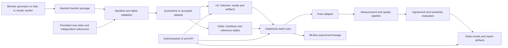

# Phase 2 solution design — equine movement measurement research platform

Version 1.0 · 17 November 2026 · Design for implementation and review, not a deployed system.

## 1. Purpose and scope

Build an operationally reliable research prototype that imports phase 1 synthetic datasets, runs pose estimation and biomechanical measurement, evaluates agreement/robustness, and exposes reproducible results through an authenticated interface. Add appropriately licensed real footage and independent references when available. Initial users: the researcher, a veterinary/biomechanics adviser, and authorized technical collaborators. Clinical use and commercial distribution are outside this release.

Research question: how do camera geometry and image quality affect agreement between markerless estimates and reference head/pelvis movement asymmetry in straight-line trot? Secondary future question: can a persistent within-horse change be distinguished from acquisition and biological variation? Early injury prediction, clinical diagnosis, return-to-work decisions and performance optimization require separate prospective evidence and are not product features here.

Phase 2 may run on a work laptop for development, but Databricks storage/jobs execute in an authorized cloud workspace. A laptop alone is not a Databricks deployment. Employer permission, dataset rights, cloud identity/networking, budget and region must be confirmed before transferring data or provisioning resources. This document does not assume those approvals already exist.

## 2. Decisions and unresolved environment inputs

| Decision | Default design | Verification before implementation |
|---|---|---|
| Cloud/provider | Use the existing authorized Databricks provider/region | AWS/Azure/GCP, workspace URL, UC enablement, networking and allowed services |
| Storage | UC Volumes for videos/artifacts; Delta tables for structured records | Managed vs external volume, retention, permission boundaries and transfer method |
| Compute | CPU batch first; NVIDIA GPU for measured inference/training need | Available GPU types/driver/runtime, quotas, access mode and job dependencies |
| Application | React/TypeScript review UI + FastAPI API, preferably hosted as one Databricks App if supported in target | Workspace Apps availability, auth, resource/network limits, framework packaging and cost |
| Fallback hosting | Approved container service for API/UI; Databricks remains batch/data platform | Identity integration, connectivity, object access, operations owner |
| Runtime | Tested Python wheel + lock, separate Blender environment | Exact library/runtime/GPU combination validated in the target workspace |
| Rendering | Keep Blender local or isolated render worker; import manifests/results | No assumption that a Databricks cluster supports interactive graphics/RTX rendering |
| Model | Existing animal pose checkpoint baseline behind an adapter | Anatomy, code/weight/data licenses, checkpoint hashes, device compatibility |
| Training | Optional fine-tuning after reference/measurement pipeline passes | Sufficient labels, independent splits, rights and measurable baseline error |

Do not provision Kubernetes, streaming infrastructure, a vector database or an LLM agent for this workload by default. The core problem is quantitative video measurement; an LLM is not needed in the inference path. Omniverse/Replicator is optional if controlled rendering at scale justifies a supported RTX worker and its licensing; Blender remains a sufficient starting renderer.

## 3. Logical architecture

An API request registers work and returns a run ID; it does not wait synchronously for video inference. A Databricks Jobs task performs decoding/inference/measurement in bounded batches, writing staging artifacts followed by an atomic result publication step. The API polls/caches authoritative run state and exposes authorized result reads. Browser clients receive no cloud secrets or broad workspace credentials.

## 4. Data engineering and governance

Use DATA_CONTRACT.md as the boundary between generator, ingestion and modeling. Keep raw media immutable, with source hashes and allowed-use records. Retain original frame timing. Preserve synthetic/real origin in every derived table and UI view. Do not silently mix simulator and real-reference accuracy summaries.

Proposed catalog layout, with names parameterized per environment:

| Schema/table | Function and key |
|---|---|
| `raw.assets`, `raw.licenses`, `raw.manifests` | Source/rights/version registry; asset_id or manifest_hash |
| `raw.ingestion_events` | Append-only accepted/rejected imports with reasons |
| `curated.trials`, `curated.cameras`, `curated.landmark_definitions` | Validated metadata and geometry |
| `curated.reference_world`, `curated.reference_projected`, `curated.events` | Separate reference domains and event origins |
| `curated.split_assignments` | Versioned group-level splits, frozen per evaluation |
| `research.inference_runs`, `research.predicted_keypoints` | Model identity, config, status and predictions |
| `research.stride_metrics`, `research.trial_metrics` | Derived values, units, exclusions and method versions |
| `research.evaluation_results` | Paired errors, aggregation level, intervals and cohort definitions |
| `research.review_annotations` | Human reviews, provenance and adjudication; never overwrite original labels |

Add columns for contract version, ingest run, source artifact hash, created UTC and transformation revision. Enforce checks and referential integrity explicitly in validation; do not rely on unenforced informational foreign keys. Partition/prune by measured query patterns and moderate-cardinality fields, not one physical partition per video frame. Benchmark before tuning.

Ingest sequence: unpack safely to a staging volume → validate schema/paths/rights/hashes/units/timing → quarantine failures → publish accepted metadata/references → make eligible for jobs. Use bounded decompression and file counts, reject symlink/path traversal, inspect actual file signatures and decode in isolation. Derived output publication is idempotent on `(source_hash, model_hash, method_version, config_hash)`. Reprocessing creates a new version rather than changing historic results.

UC governs access to volumes/tables; direct object-store credentials can bypass those controls if separately granted. Align cloud IAM with UC policy rather than assuming UC alone prevents all direct access. Use managed volumes for Databricks-only artifacts unless external render/API access requires an approved external volume and cloud IAM design. Media stays in files, not base64 blobs in Delta rows.

## 5. Processing and job orchestration

Versioned Python packages expose `validate`, `decode`, `infer`, `measure`, `evaluate`, `report` entry points. Thin job tasks invoke the same library tested locally; notebooks are exploratory or wrappers, not the only source of production logic.

Job DAG:

1. Validate accepted dataset manifest, permissions and evaluation split.
2. Decode/probe clip in resource-limited worker; verify presentation timestamps and bounds.
3. Infer anatomical landmarks in bounded batches; persist model outputs and missingness.
4. Apply a frozen preprocessing/event-detection configuration; retain valid contiguous segments and exclusion reasons.
5. Compute per-stride and per-trial metrics with explicit coordinate domain/units.
6. Align with the appropriate reference using a frozen development-derived synchronization method.
7. Evaluate paired agreement, coverage and camera sensitivities; publish versioned tables and reports.

Initial orchestration can map independent clips across tasks/workers, constrained by platform task limits and measured GPU utilization. Use manifest shards for larger sets. Do not place a video in each Spark row or launch a full model independently per frame. Where Spark is used, initialize models per appropriate worker/process and avoid serializing large weights repeatedly. Keep device selection explicit.

Run states: `queued`, `validating`, `running`, `evaluating`, `succeeded`, `failed`, `cancelling`, `cancelled`, `quarantined`. Publish failure code/stage and retryability. Retry transient storage/worker failures with bounded backoff; do not retry invalid geometry or unsupported anatomy indefinitely. A run is successful only after required artifacts and quality statuses are committed. Reconcile orphaned work with job state after API/worker restart.

## 6. AI and scientific evaluation

Pose adapter input: decoded frames, timestamps, model version and preprocessing config. Output: frame/landmark x/y, confidence, availability and model/run IDs. Reference labels remain inaccessible to inference except in explicitly declared training jobs. Generic horse keypoints may not match poll/sacrum; document and resolve mismatch rather than silently renaming landmarks.

MLflow records data manifest hashes, split version, training/eval configuration, software/environment, model hash, metrics, failure coverage and artifacts. Register eligible models in UC with signatures and environment dependencies. Resolve any model alias to an immutable version/hash at run start; results always retain that version. A registry entry means governed software, not validated clinical performance.

Evaluation suites:

- **Known-answer:** numerical signals, projection/timing fixtures, surface attachments, event sign/units and injected changes.
- **Synthetic camera robustness:** matched underlying motion across views; report per-condition error and usable coverage, within-asset scope and rendering assumptions.
- **Synthetic-to-real transfer:** only when licensed real references exist; report this separately from synthetic performance.
- **Real paired agreement:** landmark error and trial-metric bias/MAE with uncertainty accounting for repeated observations within horses. Correlation is supplementary, not agreement.
- **Repeatability:** same-file computational reproducibility versus repeated acquisitions, days and annotators reported separately.
- **Operational:** throughput, latency, memory, decode failures, invalid input handling and reproducibility across approved devices.

Freeze endpoints, exclusions and splits before held-out evaluation. Keep all horse/asset/motion derivatives grouped. One synthetic horse does not support population generalization, even with many textures or views. Few real horses require individual results and explicit uncertainty limitations. Establish scientific error tolerances with a veterinary/biomechanics adviser and reference uncertainty; no clinical thresholds are supplied by this design.

Optional fine-tuning gate: demonstrate baseline failure on the correct landmarks, verify all training rights, acquire reviewed labels, freeze independent held-out groups, and define improvement criteria before training. Compare before/after landmark and downstream metric error plus coverage. Do not select models only by attractive overlays. Synthetic-only results cannot justify deployment for clinical decision making.

## 7. API and application experience

Proposed FastAPI contracts:

| Endpoint | Behavior |
|---|---|
| `POST /v1/datasets/imports` | Register approved dataset object/volume reference and manifest hash; return import ID |
| `GET /v1/datasets/{id}` | Metadata, rights summary, origin, quality and available outputs |
| `POST /v1/runs` | Dataset/trial selection, immutable model/method/config IDs and idempotency key; return HTTP 202 + run ID |
| `GET /v1/runs/{id}` | State, progress by stage, failures, resolved provenance |
| `POST /v1/runs/{id}/cancel` | Idempotent cancellation request, not immediate success if work is still stopping |
| `GET /v1/runs/{id}/results` | Paginated metrics with domain, units, exclusions and uncertainty |
| `GET /v1/artifacts/{id}` | Authorized streaming or short-lived scoped download; no arbitrary file paths |
| `POST /v1/reviews` | Append reviewer annotation linked to a result, without modifying source |

Validate requests with typed schemas and stable error codes. Authorize every object reference, not just login. Use an app service principal with least privilege for jobs/data; apply user permissions server-side. Restrict cross-origin requests; protect state-changing browser endpoints according to auth mechanism; rate-limit expensive run creation. If direct uploads are introduced, enforce size/duration/type limits and a controlled ingest flow. Initial release may accept registered datasets only.

UI flow: dataset list → trial/view selection → acquisition/quality details → synchronized video/landmark overlay and trajectory plot → stride review → paired-reference evaluation → provenance/export. Show synthetic origin, units, anatomical definitions and quality status persistently. Align overlays using actual timestamps, not assumed browser frame callbacks. Provide reference/prediction legend and missingness. Hide reference overlays by default during blinded annotation.

Show error and coverage together. A result withheld for insufficient data should explain why, never display zero asymmetry. No lame/sound traffic lights, injury probabilities or performance rankings. Include keyboard interaction, captions/text equivalents, readable chart contrast, downloadable CSV/JSON and responsive layouts. Prevent expensive jobs from being accidentally duplicated by a double click.

## 8. Security, privacy and permissions

Roles: viewer (authorized results), researcher (register permitted data/run analyses), reviewer (annotate), operator (deployment/jobs), administrator (grants/retention). Scope actual permissions to datasets/projects. Store identities, secrets and service credentials using approved platform identity/secret facilities; use short-lived CI credentials where available. Never put tokens in source, reports, URLs or browser bundles.

Treat decoders and asset importers as processing untrusted inputs. Use patched dependencies, isolated workers, CPU/memory/time/output bounds, no unnecessary network access and disabled embedded Blender script execution. Log run/dataset access and configuration changes without leaking media or credentials. Human handlers/owners may be identifiable in future real footage; use consent, restricted access, de-identification and retention rules appropriate to the approved protocol.

License review and employer authorization are required before transfer; this is a real unresolved dependency, not an assumed permission. Keep a data-use matrix specifying local research, employer processing, training, rendered media release and redistribution separately. Operator actions cannot broaden asset rights.

## 9. Testing, CI/CD and release criteria

Local CI: formatting/type checks, numerical tests, schema/contract fixtures, failure cases, split-leakage checks, deterministic reference tests and safe-import validation. Include one self-created geometric fixture freely redistributable with tests. GPU checks run only where supported, with explicit numeric tolerances. Never demand image-byte identity across different render devices.

Integration: small accepted dataset through ingestion → inference adapter → metrics → evaluation → export; invalid manifests quarantine; retry/resume produces no duplicate published results; cancellation records actual final state. API auth tests verify cross-user/project denial. Browser tests exercise synthetic labeling, overlay timing, unavailable results, keyboard navigation and export provenance.

Databricks deployment: versioned Declarative Automation Bundles for jobs, parameters, experiments, permissions and supported app resources; cloud infrastructure definitions only for resources that require them. Pin CLI/dependencies/runtime in tested configurations. Environments: local → development → test → sandbox release; separate schemas/storage/identities. `bundle validate` and tests precede deploy; a frozen smoke experiment follows. Cloud-specific bundle fields must be selected from the target provider docs, not copied blindly from this provider-neutral design.

Release package: code/revision, dependency lock/SBOM, model/data cards, schemas, configs, test/eval reports, deployed resource versions, limitations and operations runbook. Release gate requires no unresolved critical access/input-validation issue, complete data provenance, correct known-answer tests, published exclusions and evaluation scope, successful restore/rollback exercise and agreed cost limits. Scientific feasibility may remain synthetic-only, but the UI/reports must state that clearly.

Rollback: retain prior app build, job bundle, model and method versions. Redeploy the prior compatible bundle/app and resolve a pinned model version; never overwrite completed historical runs. Use expand/contract table migrations with versioned readers. Reprocessing after a change creates new results linked to prior versions.

## 10. Operations, cost and acceptance targets

Monitor queue depth, stage duration, processed frames/sec, decode error rate, job failure/retry rate, GPU/CPU utilization, disk/memory, storage growth, usable-stride coverage and model/data-quality drift. Alert an operator on sustained job failures or stalled work; scientific quality shifts should trigger review, not automatic clinical alerts.

Initial engineering targets, subject to pilot measurements: one authorized researcher and one active analysis job; run creation/status requests complete within 2 seconds under this load; status refresh every 5–10 seconds; invalid manifests never enter inference; successful reruns reuse compatible validated artifacts. Set batch completion targets from measured clip/model/device benchmarks rather than promising real-time video processing.

Budget controls: cap concurrent jobs and GPU duration, configure job timeouts and idle termination where supported, tag experiments/projects, estimate render cost before a batch, retain expensive PNG/depth archives only according to a documented reproducibility policy, and review storage/compute use per experiment. No specific dollar estimate is defensible before cloud/runtime/volume are known.

Backup/restore covers manifests, licenses, configs, source media required for reproducibility, Delta metadata/results, model artifacts and release definitions. Time travel alone is not the entire backup plan. Proposed sandbox goals: ≤24 hours of metadata loss and restoration within one working day; verify these with the actual storage and platform setup before promising them. Preserve content hashes across transfers. Quarantine is separate from ordinary accepted-data retention.

## 11. Implementation backlog and exit gates

| Work package | Deliverable | Acceptance |
|---|---|---|
| P2-01 Environment and authorization | Provider/runtime/storage/identity/cost inventory and allowed-use matrix | Employer and asset/data permissions confirmed for intended processing |
| P2-02 Phase 1 import | Manifest validator, staging/quarantine, volumes and initial Delta tables | Copied pilot hashes/geometry/timing valid; replay idempotent |
| P2-03 Measurement core | Typed library, versioned metrics and event preprocessing | Known-answer suite passes; units/sign/exclusions explicit |
| P2-04 Pose baseline | Adapter, checkpoint inventory and batch job | Correct anatomy or documented endpoint restriction; frozen benchmark recorded |
| P2-05 Evaluation | Synthetic matched-view report, split checks and MLflow lineage | Error and coverage published; no inflated subject-generalization claim |
| P2-06 UI/API | Dataset/run/review/export workflow and auth | Browser/API integration passes including failed/insufficient cases |
| P2-07 Operations | Bundles, CI, telemetry, secrets, limits and rollback | Frozen smoke run and restore/rollback exercise pass |
| P2-08 Optional real validation/fine-tuning | Licensed references, reviewed labels and held-out report | Independent horses/groups; no tuning on final test outcomes |

A minimum viable phase 2 release comprises P2-01 through P2-07 using permitted synthetic data and a clearly scoped pose/measurement baseline. P2-08 is a separate evidence expansion. Do not delay a transparent research release while implying clinical validity that has not been demonstrated.

## 12. Phase 1 to phase 2 handover checklist

- Asset audit with rig/motion/texture findings and per-component rights evidence.
- Working generator with tested Blender/FFmpeg/host versions, code hashes and resolved configurations.
- Clean videos, reference coordinates, camera calibration, events, visibility, quality and checksums.
- Pilot and camera-experiment report, failed-case examples, measured rendering/storage requirements.
- Documented coordinate/time/unit/anatomical definitions and assumptions; exact metric/event conventions.
- Frozen split assignments and provenance groups; synthetic-only scope clearly marked.
- Pose baseline status and code/weight license inventory if already implemented.
- No secrets or unapproved assets in the transfer archive; checksum verification after arrival.

Open decisions to resolve on arrival: work laptop OS/resources; cloud/provider/region; Databricks edition/features and UC permissions; available CPU/GPU; approved app hosting/auth; allowed storage/retention; actual users/budget; veterinary adviser; available real paired datasets and their permissions.
